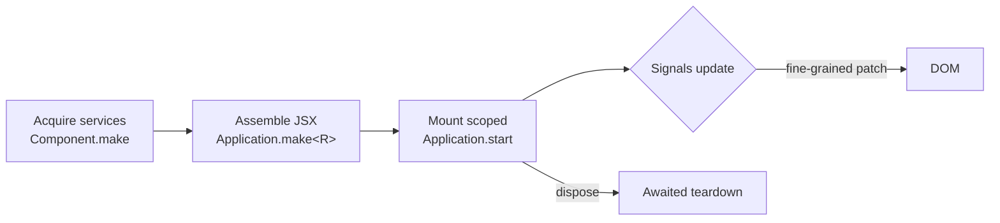

<div align="center">

# @effect/ui

**Effect-native browser UI.** Acquire dependencies as Effects, compose closed JSX tags, and update the DOM through fine-grained signals — no rerenders.

[](https://github.com/jbt95/effect-ui/actions/workflows/ci.yml)
[](./LICENSE)


[API reference](docs/API.md) · [Migration guide](docs/MIGRATION.md) · [Live demo](#demo) · [Browser support](docs/BROWSERS.md)

</div>

Built on Effect v4. The package is private and pre-1.0; the current API uses
module namespaces and acquired, dependency-closed JSX tags.

## Why @effect/ui?

- **Dependencies up front, JSX after.** `Component.make` acquires services and returns a closed tag. If it compiles, it mounts — missing services fail typecheck, not runtime.
- **Signals, not rerenders.** Components build their tree once; `Signal` updates patch only the bound DOM nodes.
- **Scoped everything.** State, selectors, resources, forks, and finalizers live and die with their subtree. Disposal awaits async cleanup.
- **Data-first async.** `Resource` holds data, `Async.View` renders it, refreshes retain the last successful DOM.
- **Replaceable backends.** Navigation (`browserLayer` / `memoryLayer`), HTTP transport, and caches are Layers — swap them in tests without touching components.



## Getting started

The package is not public yet. Once a release is available, install
`@effect/ui` and `effect` with your package manager. Use a TypeScript-aware
browser bundler and this JSX configuration:

```json
{
  "compilerOptions": {
    "target": "ES2022",
    "lib": ["ES2022", "DOM", "DOM.Iterable", "ESNext.Disposable"],
    "module": "ESNext",
    "moduleResolution": "bundler",
    "jsx": "react-jsx",
    "jsxImportSource": "@effect/ui",
    "strict": true
  }
}
```

Add `<div id="app"></div>` to your page, then start an application:

```tsx
import { Application, Component, Signal } from "@effect/ui"
import { Effect, Layer } from "effect"

const Counter = Component.local(() =>
  Effect.gen(function* () {
    const count = yield* Signal.make(0)
    return <button onClick={count.update((n) => n + 1)}>Count: {count}</button>
  })
)

const App = Application.make()(Effect.succeed(<Counter />))
const running = await Application.start(
  App,
  document.querySelector<HTMLElement>("#app")!,
  Layer.empty
)

// At application shutdown, await all instance and service finalizers.
await running.dispose()
```

The final line is the shutdown path, not part of normal startup. A host should
retain the handle and await disposal when removing the application. The browser
demo also registers page cleanup; browsers cannot guarantee completion of async
work during document shutdown.

Only ESM entry points are provided. `ESNext.Disposable` supplies types used by
Effect's declarations; it does not enable SSR or require a browser polyfill.

## Acquire dependencies, then compose JSX

`Component.make` is an Effect that acquires application dependencies and returns
a closed JSX tag. Acquire services **before** returning the renderer; create
instance state, resources, selectors, and lifecycle actions **inside** it.

```tsx
import { Application, Component, Lifecycle, Signal } from "@effect/ui"
import { Context, Effect, Layer } from "effect"

class Labels extends Context.Service<Labels, { readonly counter: string }>()("Labels") {}

const Counter = Component.make(
  Effect.gen(function* () {
    const labels = yield* Labels
    return (props: { readonly initial: number }) =>
      Effect.gen(function* () {
        const count = yield* Signal.make(props.initial)
        yield* Lifecycle.onMount(Effect.sync(() => console.info("Counter mounted")))
        yield* Lifecycle.onCleanup(Effect.sync(() => console.info("Counter removed")))
        return (
          <button onClick={count.update((n) => n + 1)}>
            {labels.counter}: {count}
          </button>
        )
      })
  })
)

const App = Application.make<Labels>()(
  Effect.gen(function* () {
    const CounterView = yield* Counter
    return (
      <main>
        <CounterView initial={0} />
        <CounterView initial={10} />
      </main>
    )
  })
)

const running = await Application.start(
  App,
  document.querySelector<HTMLElement>("#app")!,
  Layer.succeed(Labels, { counter: "Count" })
)
```

Each mounted counter has independent state. `Component.local(renderer)` declares
a tag needing only instance scope/lifecycle; `Component.sync(renderer)` declares
a pure props-to-JSX tag. Public types live in their namespaces, such as
`Component.Component<Props, Error>` and `Element.ElementChild`.

`Application.make<R>()` declares the application's service contract explicitly.
Ordinary JSX does **not** infer a tree-wide environment: acquire factories in
the assembly Effect, then compose their closed tags. Async service acquisition
and layers are supported; component rendering itself remains synchronous. Use
`Async.View` for asynchronous DOM content.

## Signals and control flow

`Signal.make` returns `Signal.Writable<A>`. `Signal.map` and `Signal.memo`
return read-only `Signal.Source<A>` values; yield a source or its `get` Effect
to read it. `.value` is a synchronous snapshot. Reactive native props retain
their scalar type: a string source cannot be used for `disabled`.

```tsx
const Tasks = Component.local(() =>
  Effect.gen(function* () {
    const visible = yield* Signal.make(true)
    const todos = yield* Signal.make<ReadonlyArray<{ id: number; title: string }>>([])
    const count = yield* Signal.map(todos, (items) => items.length)
    return (
      <section>
        <p>Tasks: {count}</p>
        <Show.View when={visible} fallback={<p>Hidden</p>}>
          <For.View each={todos} keyOf={(todo) => todo.id}>
            {(todo) => <p>{todo.title}</p>}
          </For.View>
        </Show.View>
      </section>
    )
  })
)
```

Import `Show` and `For` from `@effect/ui` for this snippet.

- `class`/`className` accept strings, nested arrays, and conditional maps;
  `style` accepts CSS text or a property object. Both accept reactive sources.
- DOM writes batch in a microtask; initial values are synchronous, and disposing
  a subtree cancels queued bindings. Signal streams expose writes independently
  of DOM coalescing.
- `Show.View` mounts and disposes its active branch. `For.View` moves retained
  keyed rows, disposes removed rows, and remounts an immutable replacement item
  with the same key so snapshot props stay current.
- `Transition.start(effect)` yields to a lower-priority scheduler turn. It
  preserves the Effect's error/environment/interruption behavior, not animations.

## Resources, async views, and HTTP

Keep loaded **data** separate from its success renderer:

```tsx
import { Async, Component, Http, ResourceCache } from "@effect/ui"
import { Effect, Schema } from "effect"

const User = Schema.Struct({ id: Schema.String, name: Schema.String })
const UserQuery = ResourceCache.key("user", {
  identify: (id: string) => id,
  load: (id) => Http.json(Http.HttpClientRequest.get(`/users/${id}`), User),
  staleTime: "1 minute"
})

const Profile = Component.make(
  Effect.gen(function* () {
    const lookup = yield* ResourceCache.bind(UserQuery)
    return (props: { readonly id: string }) =>
      Effect.gen(function* () {
        const user = yield* lookup(props.id)
        return (
          <section>
            <Async.View
              source={user}
              pending={<p role="status">Loading…</p>}
              success={(value) => <h2>{value.name}</h2>}
              failure={() => <p role="alert">Could not load the profile.</p>}
            />
            <button onClick={user.refresh}>Refresh</button>
          </section>
        )
      })
  })
)
```

Acquire `Profile` inside an
`Application.make<ResourceCache.Cache | Http.HttpClient.HttpClient>()` assembly
and start it with `Layer.mergeAll(ResourceCache.layer, Http.layer())`.
Queries are inert definitions: invoking a query produces an Effect requiring
the cache and loader services; `ResourceCache.bind` captures those dependencies
before a query enters an instance renderer.

`Resource.make(effect)` is the per-instance alternative without a shared cache.
Resources expose read-only pending/success/failure/cancelled state, `refresh`,
and `cancel`. `Async.View` accepts a Resource or a closed Effect, interrupts
scoped pending work on removal, and retains successful DOM during refresh.
Its `failure` renderer receives a typed `Cause<E>`.

`Http.layer(options)` provides Effect's Fetch client and shared middleware.
`Http.json(request, schema)` checks success status and decodes JSON. HTTP modules
are available as `Http.HttpClient`, `Http.HttpClientRequest`, and
`Http.HttpClientResponse`. BFF rewriting is a same-origin path helper, not a
CORS bypass or browser-side proxy. See [`example/Http.tsx`](example/Http.tsx).

## Navigation

```tsx
import { Application, Link, Navigation, Route, Router } from "@effect/ui"
import { Effect } from "effect"

const App = Application.make<Navigation.Service>()(
  Effect.gen(function* () {
    const Anchor = yield* Link.make()
    const Outlet = yield* Router.make({
      routes: [
        Route.make("/", { render: () => <p>Home</p> }),
        Route.make("/about", { render: () => <p>About</p> })
      ],
      notFound: <p>Page not found</p>
    })
    return (
      <>
        <Anchor to="/about">About</Anchor>
        <Outlet />
      </>
    )
  })
)
```

Start with `Navigation.browserLayer`, or use `Navigation.memoryLayer("/")` for
tests/adapters. `Route.make` is a pure declaration. Routes support nested
layouts, closed async loaders, lazy modules, pending/error UI, and inherited
title/description metadata. Acquire loader dependencies before defining routes.

Acquired links are semantic anchors with active/current-page state and lazy-route
intent prefetching. Modified clicks, external links, downloads, target links,
and hash scrolling retain native behavior. `Navigation.navigate` and
`Navigation.prefetch` require the navigation service; use `Action.bind` during
acquisition to expose closed event actions.

## Forms, images, and lifecycle

- `Form.make({ initial, validate, onSubmit })` creates controlled values,
  read-only errors/submitting state, and closed submit/reset actions.
  `Form.field(values, key)` provides a reactive field and immutable writes.
  `form.onSubmit` prevents native navigation; other events do not automatically
  prevent browser defaults. See [`example/Directory.tsx`](example/Directory.tsx).
- `Ref.make<T>()` declares a native-element ref, assigned on insertion and
  cleared on disposal. `Focus.focus`, `Focus.blur`, and `Focus.first` are Effects;
  they do not implement focus trapping or restoration.
- `Image.View` (or `yield* Image.make(props)`) renders a native image with required
  `alt`, `width`, and `height`, lazy loading by default, optional `decode`, and a
  failure fallback. `Image.preload` uses the native browser loader/cache.
- `Lifecycle.onMount(action)` and `Lifecycle.onCleanup(action)` accept Effects,
  not callbacks. Wrap native work in `Effect.sync`/`Effect.promise`. Cleanup must
  have no expected errors; handle those before registration. Instance finalizers,
  selectors, and forked fibers live until their subtree is disposed.
- Event props accept closed Effects or native callbacks returning void/a closed
  Effect. Failures go to `ErrorBoundary.View` or mount-level `onError`; running
  event Effects are interrupted on element disposal. A boundary reset recreates
  its descendants, but a boundary is not a security boundary.

`VirtualList.make` and `VirtualTable.make` are headless, scoped fixed-size
controllers with read-only windows, ARIA attributes, and keyboard actions. Hosts
own positioning, scrolling, and resize observation. Collections are snapshotted;
recreate controllers for changed data/key sets. See
[`example/Virtualized.tsx`](example/Virtualized.tsx).

## Demo

Run `bun run dev` and open the demo page — every example below mounts live,
side by side:

| Demo                                   | Shows off                                                                                                       |
| -------------------------------------- | --------------------------------------------------------------------------------------------------------------- |
| Counter, Clock, Todos                  | Services, signals, derived selectors, keyed lists                                                               |
| [Directory](example/Directory.tsx)     | Nested routing, async loaders, lazy routes, metadata, forms                                                     |
| [Console](example/Console.tsx)         | Everything at once: routing, cached queries with refresh, settings form, virtualized audit trail, activity feed |
| [Resources](example/Resources.tsx)     | Shared cache entries, memoized selectors, transitions, image preload                                            |
| [Virtualized](example/Virtualized.tsx) | 2,000-row listbox and two-axis grid with keyboard navigation                                                    |
| [Http](example/Http.tsx)               | Schema-decoded client, BFF rewriting, interceptors, query caching                                               |

## Testing and development

`Testing.render(appOrClosedJsx)` is a scoped Effect. `Testing.fireEvent`,
`Testing.fireInput`, and `Testing.waitFor` are Effects; text queries are pure.
The view's `close` is an Effect, and leaving the test scope awaits cleanup.
There is no global cleanup registry. Import `Testing` from the root or use the
`@effect/ui/Testing` / `@effect/ui/testing` subpaths.

The testing pyramid, cheapest first:

- Unit and component checks in Happy DOM (`bun run test`): signals, resources,
  routing, forms, virtualization, and lifecycle/rollback guarantees.
- Seeded property checks (`test/PropertyTest.ts`, same command): virtualizer
  geometry invariants, key-token uniqueness, and route-matching laws over
  generated inputs. Deterministic by seed; no extra test dependency.
- Integration flows (`test/ConsoleIntegrationTest.tsx`, same command): the
  `example/Console.tsx` operations console under memory navigation, covering
  cached queries, invalidation/refresh, forms, and cross-page activity.
- Packaged-consumer checks (`bun run test:package`): every public ESM entry
  point imported plus strict NodeNext declaration typechecking of the tarball.
- Real-browser smoke (`bun run test:browser`): WebDriver-driven reactive,
  routed, focus, disposal, and image-decode checks. Required per supported
  engine before release; Happy DOM is not browser evidence.
- Benchmarks (`bun run bench:runtime`): coalescing/fanout regression assertions
  plus timing output.

```bash
bun install
bun run dev
bun run typecheck
bun run lint
bun run format:check
bun run test
bun run test:browser       # running Vite server + W3C WebDriver required
bun run bench:runtime
bun run build:lib
bun run typecheck:package
bun run test:package       # Node.js 24+, npm, tar; installed Effect, no registry
bun run build
bun run ci                # sequential local CI gate
```

Module subpaths such as `@effect/ui/Component` support
`import * as Component from "@effect/ui/Component"`. The built ESM package also
exports JSX runtimes. Deprecated flat interfaces are isolated at
`@effect/ui/legacy`; new code should use the namespace API.

See the [API reference](docs/API.md), [migration guide](docs/MIGRATION.md),
[accessibility/security guidance](docs/ACCESSIBILITY_AND_SECURITY.md), and
[browser matrix/smoke instructions](docs/BROWSERS.md). Publishing policy is in
[docs/RELEASING.md](docs/RELEASING.md).

## Current boundaries

- Browser DOM only; no server components, SSR, or hydration.
- Instance rendering is synchronous; async content belongs in `Async.View`.
- JSX covers native scalar DOM props and common SVG attributes, not every
  browser-specific property/event.
- Raw HTML/content sinks, script elements, SVG animation elements, unsafe URL
  schemes, and embedded-document `data:` URLs are rejected. These checks are
  defense in depth, not a universal sanitizer.
